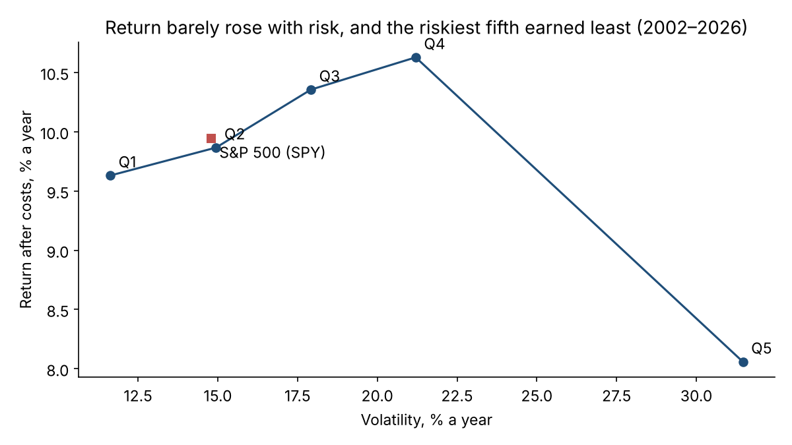
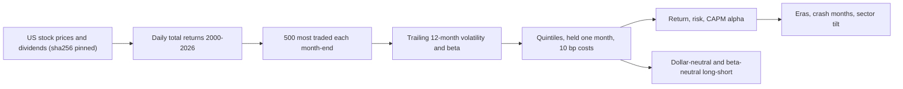

# Do boring stocks win? The low-volatility anomaly in US stocks, 2002–2026

Finance theory says riskier stocks should earn more. A large body of research says the opposite: low-volatility stocks have earned about as much as high-volatility ones, with far less risk, and "minimum volatility" funds now manage large sums on that premise. This project tests it on the 500 most traded US stocks each month from February 2002 to October 2026, with the rule fixed in advance: what does the low-volatility fifth actually deliver after costs, and is there a tradable long-short premium behind it?

## Results

- **Less risk, the same return.** The lowest-volatility fifth of stocks returned 9.63% a year after costs with 11.6% volatility; the S&P 500 (SPY) returned 9.94% with 14.8%. Sharpe ratio 0.70 against 0.60; worst drawdown 39% against 51%.
- **The riskiest stocks earned least.** The highest-volatility fifth returned 8.06% a year with 31.5% volatility (Sharpe 0.35, worst drawdown 70%). Return rose only slightly from the first to the fourth fifth (9.6% to 10.6%) while risk nearly doubled.
- **It protects, but costs in rallies.** In the 30 worst months for SPY the low-volatility fifth lost 4.5% on average, SPY 7.7% and the high-volatility fifth 13.9%. It captured 70% of SPY's up months and 53% of its down months. In 2020–2026 it returned 7.5% a year against SPY's 14.9%.
- **The long-short premium is weak.** Low minus high, dollar-neutral, averaged −2.8% a year (it is short a beta of 1.1). Its CAPM alpha is 7.4% a year but not significant at the pre-registered bar (t = 1.87). Levering the low leg and scaling down the high leg to equal beta earned 5.5% a year on average (t = 1.40), with a 63% worst drawdown.
- **Sector tilt is part of it.** On average 18% of the low-volatility fifth was consumer staples and 18% utilities. Ranked within sectors, the low-minus-high alpha falls to 5.4% (t = 1.78).
- **Today (30 October 2026):** the low-volatility fifth has an ex-ante beta of only 0.17 (financials 30%, utilities 17%); the high-volatility fifth has a beta of 2.8 and is 58% technology.

Pre-registered hypotheses: H1 (higher Sharpe for low volatility) holds; H2 (raw return at least as high) holds, narrowly; H3 (long-short CAPM alpha with t > 2) is rejected (t = 1.87); H4 (sector-neutral) is rejected (t = 1.78).



## The commercial case

| Element | What it is |
|---|---|
| Who pays | Wealth platforms and RIAs selling minimum-volatility sleeves, pension and insurance equity allocators, factor ETF issuers and consultants doing manager research |
| The problem | Low volatility is sold as "better returns with less risk"; the data supports "similar returns with less risk", and long stretches of lagging (7.5% vs 14.9% a year in 2020–26) |
| The product | A defensive-equity diagnostic: the client's low-volatility sleeve decomposed into beta, sector tilt and residual alpha, with up/down capture and a monthly drawdown budget |
| Proof | 297 months, 500 stocks, rule fixed in advance, past-data signals, 10 bp costs, three eras, sector-neutral check |
| Build vs buy | 2–3 weeks on the client's holdings and public prices; most teams rely on the index provider's factsheet |
| Pricing logic | Illustrative: on $100m, the low-volatility fifth's shallower worst drawdown was worth $11.4m; $40–80k a year per mandate |
| Adoption risk | The honest answer, "a risk tool, not an alpha source", is harder to market than the anomaly story |
| KPI | Drawdown and up/down capture against the policy benchmark; residual alpha after beta and sector |

## Method

1. Data: daily closes and cash dividends of US operating companies from a public mirror (checksum-pinned); total return includes dividends on ex-dates. Bad prints (above +100% or below −90% in a day) removed; holiday-only print days dropped.
2. Universe at each month-end: the 500 most traded stocks by average daily dollar volume over the trailing 252 days, price at least $5, at least 200 valid returns and no more than 10% zero-return days in the window.
3. Signal: annualised volatility of daily returns over the trailing 252 days (beta against SPY as a sensitivity), using only data up to the month-end.
4. Portfolios: equal-weighted quintiles, held one month, 10 bp one-way cost on names that change. Delisted names earn 0 after their last price.
5. Tests (fixed in advance): Sharpe and return by quintile; CAPM alpha with Newey-West errors (3 lags); low-minus-high dollar-neutral and beta-neutral (low leg scaled to 1/beta, high leg to 1/beta, funded at the 3-month bill); sector-neutral ranking; eras 2002–09, 2010–19, 2020–26; the 30 worst SPY months.



## Run it

```
pip install -r requirements.txt
make ingest   # downloads the public files (~0.6 GB), checks sha256, writes the extracts
make run      # reports/metrics.json, monthly_returns.csv and figures
make test
```

## Limits

- The mirror has no delisted companies, so failures are missing; this flatters the high-volatility fifth most, which works against the finding.
- Equal-weighted quintiles of the 500 most traded stocks, not a cap-weighted index; minimum-volatility indices use optimisers and constraints and will differ.
- The beta-neutral version assumes leverage at the bill rate and is sensitive to small ex-ante betas.
- Independent research on public data; not deployed; not investment advice.

## Data and licences

- Prices, dividends and profiles: [huggingface.co/datasets/defeatbeta/yahoo-finance-data](https://huggingface.co/datasets/defeatbeta/yahoo-finance-data) (ODC-BY); 3-month bill from the US Treasury par yield curve in the same mirror (public domain). Files pinned by sha256 in `configs/default.yaml`.

## References

- Ang, A., Hodrick, R. J., Xing, Y. and Zhang, X. (2006), "The Cross-Section of Volatility and Expected Returns," *Journal of Finance* 61(1), 259–299.
- Baker, M., Bradley, B. and Wurgler, J. (2011), "Benchmarks as Limits to Arbitrage: Understanding the Low-Volatility Anomaly," *Financial Analysts Journal* 67(1), 40–54.
- Frazzini, A. and Pedersen, L. H. (2014), "Betting Against Beta," *Journal of Financial Economics* 111(1), 1–25.
- Newey, W. K. and West, K. D. (1987), "A Simple, Positive Semi-Definite, Heteroskedasticity and Autocorrelation Consistent Covariance Matrix," *Econometrica* 55(3), 703–708.

Code MIT-licensed. Code, analysis, charts and text were produced with AI assistance (Claude, by Anthropic) and reviewed by Gaurav Gupta.
